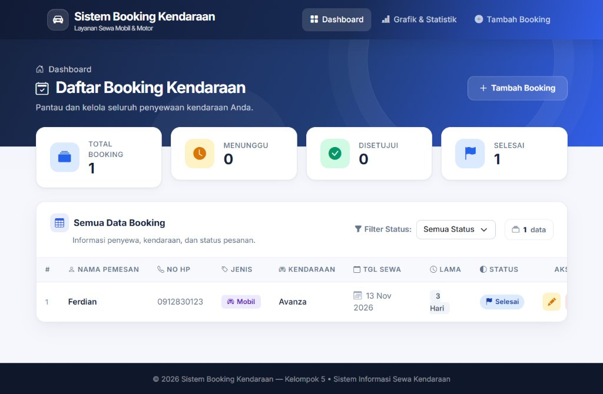

# 🚗 Sistem Booking Kendaraan (Kelompok 5)

[](https://kelompok-5-noss-ecru.vercel.app/bookings)
[](https://laravel.com)
[](https://php.net)

> **Website Live / Demo Online:**  
> 🔗 **[https://kelompok-5-noss-ecru.vercel.app/bookings](https://kelompok-5-noss-ecru.vercel.app/bookings)**

---

## 📸 Preview Tampilan Aplikasi



---

## 📌 Deskripsi Sistem

**Sistem Booking Jasa Sewa Mobil & Motor** adalah aplikasi berbasis web yang dibangun menggunakan *framework* **Laravel** untuk mengelola transaksi pemesanan rental kendaraan secara terstruktur, modern, cepat, dan efisien.

Aplikasi ini dikembangkan oleh **Kelompok 5** untuk memenuhi penugasan final project mentoring web development.

---

## ✨ Fitur Utama

Aplikasi ini menyediakan fungsionalitas manajemen pemesanan secara penuh:

* 📊 **Dashboard & Statistik Bisnis**: Ringkasan data KPI serta grafik visual (Chart.js) untuk memantau tren booking, perbandingan armada (Mobil vs Motor), dan rasio status pesanan.
* 📋 **Daftar Pemesanan (Read)**: Menampilkan seluruh data transaksi booking dalam tabel interaktif dengan indikator status berikon vektor modern.
* 🔍 **Filter Status Real-time**: Memfilter daftar sewa berdasarkan status (`Menunggu`, `Disetujui`, `Selesai`, `Batal`).
* ➕ **Formulir Tambah Booking (Create)**: Input pemesanan kendaraan baru dengan validasi data terintegrasi, disusun dalam tata letak responsif 2 kolom tanpa perlu scroll.
* ✏️ **Edit Data & Status (Update)**: Memperbarui rincian pelanggan, jenis kendaraan, dan memperbarui status operasional.
* 🗑️ **Hapus Pemesanan (Delete)**: Menghapus rekaman transaksi sewa dari sistem.
* 📱 **Desain Fleksibel & Responsif**: Tampilan nyaman diakses di smartphone, tablet, maupun layar desktop monitor (lengkap dengan mobile hamburger menu dan sticky navbar).

---

## 🛠️ Spesifikasi Teknologi

| Komponen | Teknologi / Alat |
| :--- | :--- |
| **Framework Backend** | Laravel (PHP 8.2+) |
| **User Interface** | HTML5, CSS3, Bootstrap 5, Bootstrap Icons |
| **Data Visualization** | Chart.js |
| **Database** | SQLite (Production Vercel) / MySQL (Lokal) |
| **Deployment / Hosting** | Vercel Serverless Platform |
| **Version Control** | Git & GitHub |

---

## 🗄️ Skema Database

Tabel utama: **`bookings`**

| Nama Kolom | Tipe Data | Atribut | Keterangan |
| :--- | :--- | :--- | :--- |
| `id` | BigInt | Primary Key, Auto Increment | Identifikasi unik transaksi |
| `nama_pemesan` | Varchar(255) | Not Null | Nama lengkap pelanggan |
| `no_hp` | Varchar(50) | Not Null | Nomor kontak/WhatsApp |
| `jenis_kendaraan` | Enum | 'mobil', 'motor' | Kategori armada kendaraan |
| `nama_kendaraan` | Varchar(255) | Not Null | Merk/tipe kendaraan |
| `tanggal_sewa` | Date | Not Null | Tanggal mulai sewa |
| `lama_sewa` | Integer | Not Null | Durasi sewa (hari) |
| `catatan` | Text | Nullable | Permintaan/catatan khusus |
| `status` | Enum | Default 'menunggu' | Status (`menunggu`, `disetujui`, `selesai`, `batal`) |

---

## 🚀 Panduan Menjalankan Secara Lokal

1. **Clone Repository:**
   ```bash
   git clone https://github.com/meganelfredaarkananta/Kelompok-5.git
   cd Kelompok-5
   ```

2. **Salin Environment:**
   ```bash
   cp .env.example .env
   ```

3. **Install Dependensi:**
   ```bash
   composer install
   npm install
   npm run build
   ```

4. **Generate Key & Migrasi:**
   ```bash
   php artisan key:generate
   php artisan migrate
   ```

5. **Jalankan Server Lokal:**
   ```bash
   php artisan serve
   ```
   Buka di browser: `http://127.0.0.1:8000`

---

## 👥 Anggota Kelompok 5
* **Megan Elfreda Arkananta**
* **Ferdian**
* Serta seluruh anggota tim Kelompok 5
